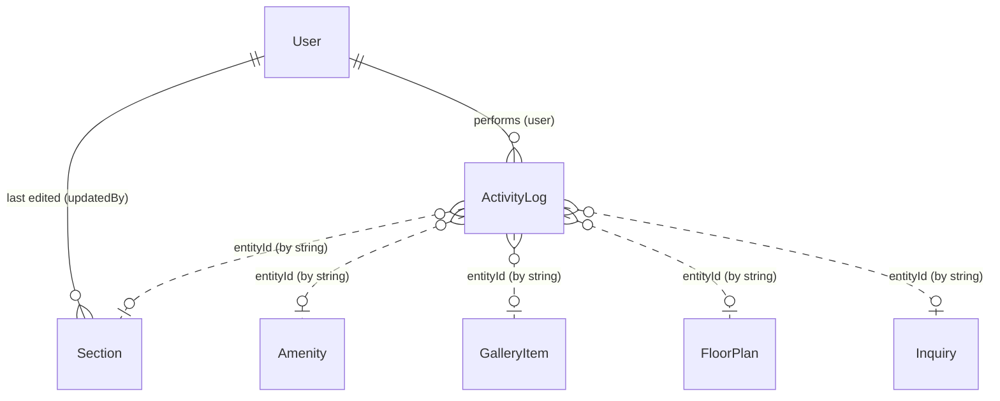

# Database schema

MongoDB (Atlas) accessed through Mongoose. Seven collections. Models live in [`server/src/models`](../server/src/models); request validation (Zod) in [`server/src/validators`](../server/src/validators).

- [Overview and relationships](#overview-and-relationships)
- [Conventions](#conventions)
- [User](#user) · [Section](#section) · [Amenity](#amenity) · [GalleryItem](#galleryitem) · [FloorPlan](#floorplan) · [Inquiry](#inquiry) · [ActivityLog](#activitylog)
- [Section.content shapes](#sectioncontent-shapes)
- [Indexes](#indexes)
- [Typical queries](#typical-queries)

## Overview and relationships



| From | To | How | Notes |
|---|---|---|---|
| `ActivityLog.user` | `User._id` | ObjectId reference | The log also stores `userEmail` as a snapshot so history survives user deletion. |
| `Section.updatedBy` | `User._id` | ObjectId reference | Set automatically on every create/update. |
| `ActivityLog.entityId` | any content document (or the `User` for password changes) | plain string (the document's id) | A *soft* link: it is not a Mongoose reference, so logs outlive deleted documents (a "delete" entry points at an id that no longer exists). `entity` says which collection. |

Everything else is intentionally flat and self-contained: the public site reads each collection independently, and there are no joins. `Section.content` is a free-form sub-document so each section can carry its own structure without a new collection per block.

## Conventions

- **Timestamps.** Every collection has `createdAt` and `updatedAt` (`ActivityLog` has `createdAt` only).
- **Draft / publish.** `Section`, `Amenity`, `GalleryItem` and `FloorPlan` share `status` (`draft` | `published`), `publishedAt` and `order`. The public API returns only `status: "published"`; the admin API returns everything. Setting `status` to `published` stamps `publishedAt` (kept if already set); returning to `draft` clears it.
- **Ordering.** `order` (integer, lower first) controls display order on the public site.
- **Media.** Images/PDFs are stored as Cloudinary `https://` URLs (strings). Validation accepts empty (not uploaded yet) or an `http(s)` URL.
- **Demo marker.** `Inquiry`, `ActivityLog`, `Amenity` and `FloorPlan` have a hidden `demo` string (`select: false`). It is only set by `npm run seed:demo` (e.g. `"inq-07"`), is never returned by any query or API, and lets `seed:demo:clear` delete exactly the demo records.
- **Validation.** Zod validates every write at the API boundary (unknown fields are stripped); Mongoose `required`/`enum` act as a second layer.

## User

Collection `users`. Admin accounts only (there is a single role).

| Field | Type | Required | Default | Notes |
|---|---|---|---|---|
| `_id` | ObjectId | auto | | |
| `name` | String | yes | | trimmed |
| `email` | String | yes | | **unique**, lowercased, trimmed |
| `passwordHash` | String | yes | | bcrypt hash; `select: false` (never loaded unless asked) |
| `role` | String | | `admin` | enum: `admin` |
| `passwordChangedAt` | Date | | | set when the password changes (admin Account page, `npm run reset-admin`, `seed --reset`). Sessions issued before this moment are rejected, which signs out every other device |
| `createdAt`, `updatedAt` | Date | auto | | |

## Section

Collection `sections`. One document per CMS block of the public page, identified by a unique `key`.

| Field | Type | Required | Default | Notes |
|---|---|---|---|---|
| `_id` | ObjectId | auto | | |
| `key` | String | yes | | **unique and immutable** (it can't be changed after creation). Built-in keys: `navbar`, `hero`, `about`, `connectivity`, `gallery`, `amenities`, `video`, `floorPlans`, `rera`, `developer`, `cta`, `footer`; any other key is a custom section. Pattern `^[a-z][a-zA-Z0-9-]{1,39}$` |
| `title` | String | | `""` | max 200 |
| `subtitle` | String | | `""` | max 300 |
| `body` | String | | `""` | max 10 000 |
| `image` | String (URL) | | `""` | |
| `content` | Mixed (object) | | `{}` | Section-specific data; see [content shapes](#sectioncontent-shapes). Any string under a key ending in `url`, `href` or `image` must be `http(s)://`, `#anchor` or `/path`. |
| `seo.metaTitle` | String | | `""` | max 70 |
| `seo.metaDescription` | String | | `""` | max 160 |
| `seo.ogImage` | String (URL) | | `""` | |
| `status` | String | | `draft` | enum `draft` \| `published` |
| `publishedAt` | Date | | | |
| `order` | Number | | `0` | |
| `updatedBy` | ObjectId → `User` | | | |
| `createdAt`, `updatedAt` | Date | auto | | |

`content` is stored with `minimize: false`, so empty objects are kept.

## Amenity

Collection `amenities`.

| Field | Type | Required | Default | Notes |
|---|---|---|---|---|
| `_id` | ObjectId | auto | | |
| `title` | String | yes | | max 120 |
| `description` | String | | `""` | max 500 |
| `icon` | String | | `Sparkles` | a [lucide](https://lucide.dev) icon name from the curated set in `client/src/utils/amenityIcons.js`; unknown names fall back to `Sparkles` |
| `image` | String (URL) | | `""` | optional |
| `status`, `publishedAt`, `order` | | | see [conventions](#conventions) | |
| `demo` | String (hidden) | | | demo marker |
| `createdAt`, `updatedAt` | Date | auto | | |

## GalleryItem

Collection `galleryitems`.

| Field | Type | Required | Default | Notes |
|---|---|---|---|---|
| `_id` | ObjectId | auto | | |
| `title` | String | yes | | caption, max 120 |
| `image` | String (URL) | yes | | |
| `category` | String | | `general` | max 60; filterable in the admin |
| `status`, `publishedAt`, `order` | | | see [conventions](#conventions) | |
| `createdAt`, `updatedAt` | Date | auto | | |

## FloorPlan

Collection `floorplans`. Areas are numbers in sq.ft so the table can sort and format them.

| Field | Type | Required | Default | Notes |
|---|---|---|---|---|
| `_id` | ObjectId | auto | | |
| `unitType` | String | yes | | e.g. `1 BHK Grand`, max 80 |
| `carpetArea` | Number | yes | | `>= 0` |
| `balcony` | Number | | `0` | `>= 0` |
| `totalArea` | Number | yes | | `>= 0` |
| `floors` | String | | `""` | free text such as `1-8` |
| `image` | String (URL) | | `""` | floor plan picture |
| `pdfUrl` | String (URL) | | `""` | downloadable PDF |
| `status`, `publishedAt`, `order` | | | see [conventions](#conventions) | |
| `demo` | String (hidden) | | | demo marker |
| `createdAt`, `updatedAt` | Date | auto | | |

## Inquiry

Collection `inquiries`. Created by visitors through the public enquiry form; admins can update `status`/`notes`, export and delete.

| Field | Type | Required | Default | Notes |
|---|---|---|---|---|
| `_id` | ObjectId | auto | | |
| `name` | String | yes | | 2-100 chars |
| `phone` | String | yes | | `^\+?[\d\s-]{7,18}$` |
| `email` | String | | `""` | lowercased; empty or a valid email |
| `message` | String | | `""` | max 1000 |
| `source` | String | | `website` | where the form was opened (`hero`, `navbar`, `cta-site-visit`, `cta-brochure`, `floor-plan`, `brochure`, ...) |
| `status` | String | | `new` | enum `new` \| `contacted` \| `closed` |
| `notes` | String | | `""` | internal, max 1000 |
| `demo` | String (hidden) | | | demo marker |
| `createdAt`, `updatedAt` | Date | auto | | |

## ActivityLog

Collection `activitylogs`. Append-only audit trail written by middleware after every successful create/update/delete/publish/unpublish in the admin.

| Field | Type | Required | Default | Notes |
|---|---|---|---|---|
| `_id` | ObjectId | auto | | |
| `user` | ObjectId → `User` | | | who did it |
| `userEmail` | String | | `""` | snapshot of the user's email |
| `action` | String | yes | | enum `create` \| `update` \| `delete` \| `publish` \| `unpublish` |
| `entity` | String | yes | | `section`, `amenity`, `gallery item`, `floor plan`, `inquiry`, `user` (password changes: summary `Changed password`, never any password data) |
| `entityId` | String | | `""` | id of the affected document ([soft link](#overview-and-relationships)) |
| `summary` | String | | `""` | human text, e.g. `Updated section "hero"` |
| `demo` | String (hidden) | | | demo marker |
| `createdAt` | Date | auto | | no `updatedAt`: logs are never edited |

## Section.content shapes

`content` differs per section `key`. Top-level `title`, `subtitle`, `body` and `image` are also used (noted in the last column). The admin's section editor is generated from these shapes (`client/src/admin/sectionConfigs.js`).

| `key` | `content` fields | Also uses |
|---|---|---|
| `navbar` | `ctaLabel`, `links[] {label, href}`, `enquiryTitle`, `enquiryIntro`, `enquirySubmitLabel`, `enquirySuccessTitle` (the enquiry pop-up's copy; each falls back to a built-in default when empty) | `title` (brand) |
| `hero` | `location`, `codename`, `projectName`, `projectSuffix`, `primaryCta {label, href}`, `secondaryCta {label, action}` | `subtitle` (tagline), `image`, `seo` |
| `about` | `highlights[]` (strings), `stats[] {value, label}`, `brochureCta {label, url}` | `subtitle` (eyebrow), `title`, `body`, `image` |
| `connectivity` | `eyebrow`, `columns[] {heading, items[] {name, minutes}}` | `title`, `subtitle`, `image` (map) |
| `gallery` | none | `subtitle` (eyebrow), `title` |
| `amenities` | `eyebrow` | `title`, `subtitle` |
| `video` | `videoUrl`, `posterImage` | `title`, `subtitle` |
| `floorPlans` | `downloadLabel` | `subtitle` (eyebrow), `title` |
| `rera` | `registrationLabel`, `registrationNumber`, `websiteUrl`, `qrCaption` | `title`, `body` (disclaimer), `image` (QR) |
| `developer` | `eyebrow`, `consultants[] {role, name}` | `title`, `subtitle`, `body`, `image` |
| `cta` | `primaryCta {label, url}`, `secondaryCta {label, url}` | `title`, `subtitle` (eyebrow), `image` |
| `footer` | `corporateOffice {heading, address, phones[], email}`, `salesOffice {...}`, `quickLinksHeading`, `quickLinks[] {label, href}`, `copyright`, `legalLinks[] {label, href}` | `title`, `subtitle`, `image` (logo) |
| *any other key* (**custom section**) | `imagePosition` (`right` \| `left`), `background` (`white` \| `sand`), `cta {label, href}` (an empty `href` opens the enquiry form) | `subtitle` (eyebrow), `title`, `body` (a blank line starts a new paragraph), `image` |

Example (`connectivity`):

```json
{
  "key": "connectivity",
  "title": "What if your home is as well connected as your ambitions?",
  "subtitle": "This is the one.",
  "image": "https://res.cloudinary.com/…/map.jpg",
  "content": {
    "eyebrow": "Location & Connectivity",
    "columns": [
      { "heading": "Connectivity", "items": [{ "name": "Chembur Railway Station", "minutes": 5 }] },
      { "heading": "Education",    "items": [{ "name": "AFAC English High School", "minutes": 1 }] }
    ]
  },
  "status": "published",
  "order": 3
}
```

## Indexes

Verified against the live models (`Model.collection.indexes()`).

| Collection | Index | Type | Serves |
|---|---|---|---|
| `users` | `{ email: 1 }` | **unique** | login lookup, duplicate prevention |
| `sections` | `{ key: 1 }` | **unique** | public `GET /sections/:key`, one document per block |
| `sections` | `{ status: 1 }` | | status filter |
| `sections` | `{ status: 1, order: 1 }` | compound | public list (published, ordered) |
| `amenities` | `{ status: 1 }` · `{ status: 1, order: 1 }` | | same pair as above |
| `galleryitems` | `{ status: 1 }` · `{ status: 1, order: 1 }` | | same pair as above |
| `floorplans` | `{ status: 1 }` · `{ status: 1, order: 1 }` | | same pair as above |
| `inquiries` | `{ status: 1, createdAt: -1 }` | compound | admin list filtered by status, newest first; dashboard status counts |
| `activitylogs` | `{ createdAt: -1 }` | | newest-first log and dashboard "latest activity" |
| `activitylogs` | `{ entity: 1, action: 1, createdAt: -1 }` | compound | log filters by entity and action |

Admin text search (`?search=`) uses case-insensitive, escaped regular expressions over a short whitelist of fields per collection. At this data size that is fast and avoids maintaining text indexes; if a collection grows into the hundreds of thousands, add a text index and switch `buildListQuery` to `$text`.

## Typical queries

| Use | Query | Index |
|---|---|---|
| Public sections | `Section.find({ status: 'published' }).sort({ order: 1 })` | `{status, order}` |
| Public amenities / gallery / plans | `find({ status: 'published' }).sort({ order: 1 })` | `{status, order}` |
| Admin inquiries by status | `Inquiry.find({ status }).sort({ createdAt: -1 })` | `{status, createdAt}` |
| Dashboard inquiry counts | `Inquiry.aggregate([{ $group: { _id: '$status', count: { $sum: 1 } } }])` | `{status, createdAt}` (can be answered from the index) |
| Log filter | `ActivityLog.find({ entity, action }).sort({ createdAt: -1 })` | `{entity, action, createdAt}` |
| Login | `User.findOne({ email }).select('+passwordHash')` | `{email}` unique |
